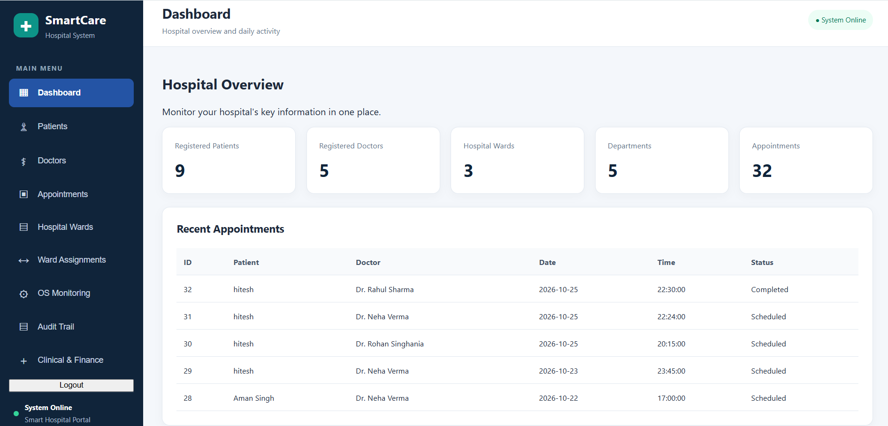
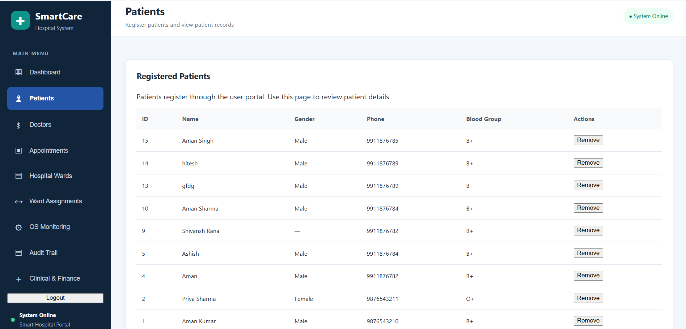
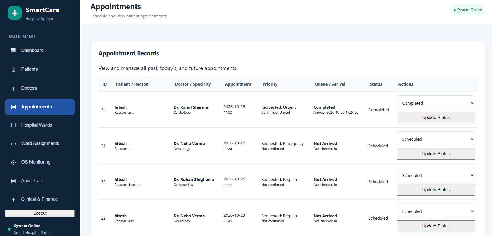
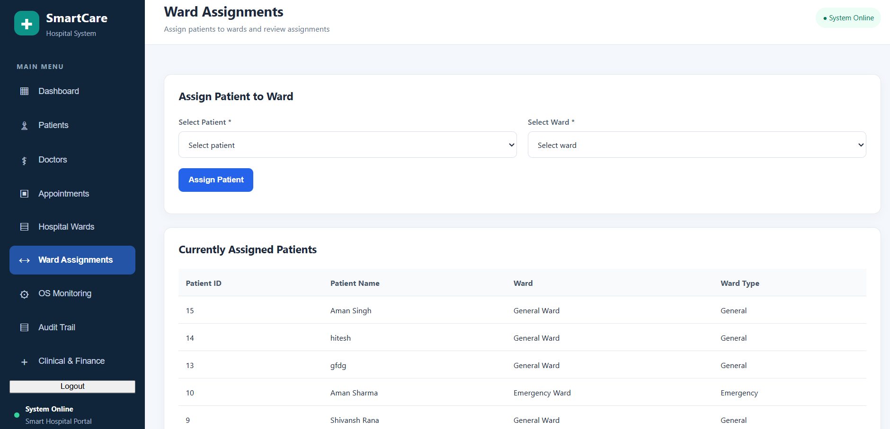

# 🏥 SmartCare
### Smart Hospital Management System

<p align="center">
  A centralized digital platform for smarter, faster and more efficient hospital operations.
</p>

<p align="center">
  
  
  
  
  
  
</p>

---

## 📖 About SmartCare

**SmartCare – Hospital Management System** is a web-based application developed to digitize and streamline essential hospital operations through a centralized platform.

Traditional hospital operations often involve manual record keeping, disconnected information and difficulties in coordinating different activities. SmartCare aims to address these challenges by integrating multiple hospital functions into one application.

The system provides modules for managing patients, doctors, departments, appointments, wards, medical records, prescriptions, medicines, billing and payments.

Beyond basic hospital management, SmartCare demonstrates the practical implementation of Operating System and Database Management System concepts, including synchronization, scheduling, transaction management, concurrency control and deadlock handling.

The project combines web development, database engineering and operating system concepts to create a practical academic software solution.

## 🎯 Project Objectives

- Digitize essential hospital operations.
- Maintain organized and centralized hospital records.
- Simplify patient registration and appointment booking.
- Improve ward allocation and capacity management.
- Provide controlled access to shared family health information.
- Maintain activity history through an audit trail.
- Demonstrate real-world applications of OS and DBMS concepts.
- Ensure data consistency during concurrent database operations.

## ✨ Key Features

### 01. Hospital Operations

| Module | Description |
|---|---|
| Dashboard | Displays important hospital statistics and information |
| Patient Management | Register, view and manage patient records |
| Doctor Management | Maintain doctor details and specializations |
| Department Management | Organize hospital departments |
| Appointment Management | Schedule and manage patient appointments |
| Ward Management | Manage wards, capacity and patient assignments |
| Medical Records | Maintain patient medical information |
| Prescriptions | Manage prescribed medicines |
| Medicine Management | Maintain medicine-related information |
| Billing | Generate and manage patient bills |
| Payments | Manage payment records |

### 02. Advanced Functionalities

**Family Health Sharing**
- Send and manage family health-sharing invitations.
- Provide controlled access to shared health information.
- Manage permissions and access revocation.

**Audit Trail**
- Maintain records of important application activities.
- Track changes and operations for better accountability.

**Live Appointment Queue Analytics**
- Manage appointment queues.
- Demonstrate FCFS and Priority Scheduling.
- Display queue-related information.

**Concurrency Control**
- Protect critical operations against conflicting concurrent updates.
- Maintain correct ward capacity using database transactions and row-level locking.

## 🏗️ System Architecture

SmartCare follows a three-tier architecture.

```text
       PRESENTATION LAYER
     HTML + CSS + JavaScript
               |
               | HTTP / REST API
               |
       APPLICATION LAYER
          Python Flask
               |
        Business Logic
        API Endpoints
        Validation
               |
               | SQL Queries
               |
         DATABASE LAYER
             MySQL
               |
      Relational Database
```

### Architecture Components

| Layer | Technology | Responsibility |
|---|---|---|
| Presentation | HTML, CSS, JavaScript | User interface and interaction |
| Application | Python Flask | APIs, business logic and validation |
| Database | MySQL | Data storage, relationships and transactions |

## 🗄️ Database Design

The database is designed around **12 main hospital tables** to organize and manage hospital information.

The database design uses:

- Primary Keys
- Foreign Keys
- One-to-One Relationships
- One-to-Many Relationships
- SQL Joins
- Constraints
- Normalization Principles
- Transaction Management
- Referential Integrity

The database is structured to reduce unnecessary data duplication and maintain consistency across related hospital records.

## ⚙️ Operating System Concepts Implementation

One of the important aspects of SmartCare is the practical implementation of Operating System concepts.

| OS Concept | Implementation in SmartCare |
|---|---|
| Mutex Lock | Synchronization during ward assignment within a Flask process |
| Semaphore | Restricts concurrent appointment operations to three within a Flask process |
| FCFS Scheduling | Appointment queue processing |
| Priority Scheduling | Priority-based appointment handling |
| Deadlock Handling | Demonstration of MySQL deadlock detection and transaction rollback |

These implementations demonstrate how synchronization and scheduling concepts can be applied to real-world application workflows.

## 🔐 DBMS Concepts Implementation

SmartCare demonstrates important database concepts through practical implementation:

**1. Transactions**

Database transactions are used to maintain consistency during important operations, such as assigning patients to wards.

**2. ACID Properties**

- Atomicity
- Consistency
- Isolation
- Durability

**3. Concurrency Control**

Row-level locking using MySQL `SELECT ... FOR UPDATE` helps prevent conflicting updates during simultaneous ward assignments.

**4. Deadlock Handling**

The project includes a practical MySQL deadlock demonstration in which a deadlock is detected and the affected transaction is rolled back.

**5. Normalization**

Database design follows normalization principles to organize relational data and reduce redundancy.

## 📸 Application Screenshots

### 1. Admin Dashboard


### 2. Patient Management


### 3. Appointment Management


### 4. Ward Management



## 🚀 Installation and Setup

### Prerequisites

Make sure you have installed:

- Python 3.x
- MySQL Server
- MySQL Workbench
- Git

### Step 1: Clone the Repository

```bash
git clone https://github.com/Shivansh11122/SmartCare-Hospital-Management-System.git
```

### Step 2: Navigate to the Project Directory

```bash
cd SmartCare-Hospital-Management-System
```

### Step 3: Create a Virtual Environment

```bash
python -m venv venv
```

Activate the environment on Windows:

```bash
venv\Scripts\activate
```

### Step 4: Install Dependencies

```bash
pip install -r requirements.txt
```

### Step 5: Configure the Database

1. Start your MySQL Server.
2. Open MySQL Workbench.
3. Create the required SmartCare database.
4. Execute the project's database SQL script.
5. Configure your local MySQL credentials in the Flask application.

### Step 6: Start the Application

```bash
python SmartCare_app.py
```

Open the local application address displayed in the terminal.

## 🧪 Testing and Validation

The project includes testing of major application functionalities:

- Patient registration and data retrieval.
- Doctor and department integration.
- Appointment booking.
- Ward assignment and capacity validation.
- Database connectivity.
- Transaction commit and rollback.
- Deadlock detection and recovery.
- Family health-sharing functionality.
- Audit trail functionality.
- Appointment queue processing.

## 🔮 Future Enhancements

Potential future improvements include:

- Online appointment notifications.
- Automated report generation.
- Enhanced role-based access control.
- Improved analytics and reporting.
- Additional security and backup mechanisms.
- Responsive mobile-friendly interface.

## 🔗 Project Repository

**GitHub:**  
https://github.com/Shivansh11122/SmartCare-Hospital-Management-System

## 🎓 Academic Information

**Project:** SmartCare – Hospital Management System  
**Degree:** B.Tech – Computer Science and Engineering  
**Project Domain:** Web Development, DBMS and Operating Systems  
**Backend:** Python Flask  
**Database:** MySQL  
**Frontend:** HTML, CSS and JavaScript

---

<p align="center">
  <b>SMARTCARE</b>
  <br/>
  <i>Smarter Hospital Operations. Better Information Management.</i>
</p>
